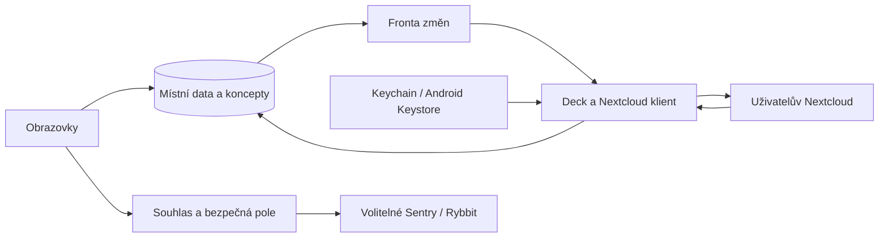

# Architektura a synchronizace

## Rozdělení

`apps/mobile` obsahuje UI, bezpečné úložiště, systémové prohlížeče, soubory a telemetrii. `packages/deck_protocol` obsahuje typované modely, Nextcloud Login Flow, REST/OCS klienta a bezpečné chyby. `packages/deck_store` obsahuje SQLite/Drift, lokální koncepty, frontu zápisů a obnovu. UI čte lokální stav přes Riverpod a sleduje změny databáze.

## Data a izolace

Každý účet má lokální UUID, normalizovanou adresu včetně podadresáře, serverové UID, odkaz na heslo v bezpečném úložišti a generaci přihlášení. Primární klíč serverové entity je vždy `(accountId, remoteId)`. Při odebrání účtu se generace zneplatní dříve, než se odstraní data; dobíhající odpověď je pak nemůže vrátit.

Tabulky: accounts, boards, stacks, cards, labels, card_labels, assignments, board_acl, comments, attachments, operations, sync_checkpoints, conflicts. Karty a ostatní nově vytvářené entity mají lokální UUID dříve než serverové ID. Fronta odkazuje na UUID a závislosti, takže založení nástěnky předchází sloupci a kartě. Zápis entity a vytvoření operace je jedna databázová transakce.

U editované karty uchovat původní serverová pole, místní verzi, ETag a číslo místní revize. Úspěšná odpověď smí potvrdit jen odeslanou revizi, ne novější editaci. Soubor čekající na upload zkopírovat do trvalého úložiště aplikace; do fronty neukládat dočasný URI grant bez jeho životnosti.

## Čtení

Nejprve zobrazit lokální kopii. Při otevření účtu načíst capabilities a seznam nástěnek. Podmíněné GET s `If-None-Match` omezí přenos; ETag je neprůhledná hodnota. Při změně otevřené nástěnky obnovit její sloupce a karty. Komentáře a přílohy načítat až na vyžádání.

`If-Modified-Since` je doplňková optimalizace, nikoli úplný protokol synchronizace. Chybějící položka v částečné odpovědi neznamená smazání. Úplný úspěšný snímek a jeho rozsah uložit atomicky; teprve potom vyhodnotit odebrané položky. Odpověď 304 nikdy nenahrazuje data prázdným seznamem.

Obnova v popředí při návratu aplikace, změně sítě a ručním obnovení. Periodický polling pouze pro viditelnou nástěnku, s prodlužováním intervalu při nečinnosti a chybách. Android WorkManager a iOS background task jsou příležitostná synchronizace; systém negarantuje přesný čas. Přítomnost editora přes Deck sessions není push synchronizace.

## Zápisy a konflikty

Stavy operace: `queued`, `sending`, `applied`, `confirmed`, `conflict`, `uncertain`, `blocked`. `applied` znamená potvrzený zápis, jehož výsledek je ještě potřeba načíst; v tomto stavu se opakuje jen GET. Jeden odesílatel na účet. Před odesláním ověřit platnost účtu, oprávnění a závislosti. Změna tokenu zruší původní klienty.

GET lze opakovat s omezeným exponenciálním zpožděním a náhodnou složkou. Respektovat `Retry-After`. POST po timeoutu neopakovat automaticky: server mohl kartu nebo komentář vytvořit. Stav `sending` po pádu se obnoví jako `uncertain`, dokud není výsledek rozhodnut. Porovnání názvu karty není důkaz identity. UI nabídne kontrolu serveru a výslovné opakování s upozorněním na možnost duplicity.

Před editací stáhnout aktuální kartu a porovnat s původním snímkem. Nesouvisející pole lze sloučit. Při souběžné změně stejného textu ponechat obě verze a požádat o rozhodnutí. Nevynucovat automatické přepsání. Deck REST update je úplnější zápis s výchozími hodnotami, proto vždy odeslat zachovaná pole a novou změnu společně.

Analyzovaná metoda aktualizace nemá atomickou podmínku `If-Match`. GET před PUT tedy nezabrání změně jiného klienta mezi oběma požadavky. OwnDeck tento limit přizná a uchová obnovitelný koncept; nesmí tvrdit, že garantuje bezeztrátovou souběžnou editaci všech klientů. Po zápisu obnovit serverový stav. Pro přísnou garanci by bylo nutné doplnit serverovou podporu, což se musí rozhodnout samostatně.

Při 401 pozastavit frontu do nového přihlášení. Při 403 zabránit dalším zápisům a obnovit práva. Koncept při ztrátě práv uchovat odděleně s možností zkopírování uživatelem; vzdálená data neprezentovat jako stále dostupná. Při 404 rozlišit smazání od nedostupného API. Při chybě validace ukázat opravitelný problém bez surové odpovědi serveru.

## Ochrana dat

Heslo pouze v Keychain/Keystore, do DB patří reference. TLS ověřuje systém; nevypínat ověřování certifikátů. Univerzální klient pro cizí Nextcloud servery nemůže mít jednu pevně připnutou certifikační identitu. Soukromé CA řešit systémovým důvěryhodným úložištěm a dokumentovaným nastavením, ne obcházením kontroly.

Nepřeposílat Authorization při redirectu. Přihlašovací a citlivé API požadavky mají redirect zakázaný. Vnější odkazy z Markdownu otevřít po validaci schématu a bez Nextcloud hlaviček. Obrázky z cizích domén automaticky nestahovat. Zálohy OS nesmějí přenášet tokeny ani nesynchronizované přílohy do jiného účtu.

Lokální databáze je chráněna sandboxem a šifrováním zařízení, není automaticky samostatně šifrovaná SQLCipherem. Tento rozdíl uvést pravdivě. Zámek aplikace může chránit vstup do UI, nikoli nahradit šifrování databáze.

## Sentry a Rybbit

Konfigurace Sentry DSN a Rybbit host/site ID se injektuje při sestavení. Admin tokeny a Sentry token pro upload symbolů patří pouze do CI secrets, nikdy do APK/IPA. Runtime ingest konfigurace je z distribuční binárky zjistitelná; nelze ji vydávat za utajený administrátorský klíč.

Vlastní build bez konfigurace nepoužije SDK. Oficiální distribuční úloha vyžaduje kompletní konfiguraci obou služeb a ověří její přítomnost bez výpisu hodnot. Runtime souhlas pro diagnostiku a statistiku je oddělený a odvolatelný. Selhání telemetrie nesmí blokovat start, přihlášení ani uložení karty.

Sentry: bezpečný kód chyby, stack, verze/build, platforma; bez URL serveru, těl HTTP, názvů, účtů a příloh. Vypnout screenshoty, replay, automatické trasování HTTP a výchozí PII. Rybbit: pouze pevné názvy obrazovek a událostí; žádná ID karet, názvy ani vyhledávaný text. Vypnout jeho automatický sběr chyb, aby raw výjimky neobešly čištění v Sentry.

Povolené události: `board_opened`, `card_created`, `card_moved`, `sync_finished` s výčtovým výsledkem a bucketem délky; obrazovky `/boards`, `/board`, `/card`, `/settings`. Vše bez dynamických identifikátorů. Odvolání souhlasu zastaví odesílání a vyprázdní případnou čekající frontu SDK. Ověřit přes skutečný příjem testovací události i nulový provoz vypnutého režimu.
